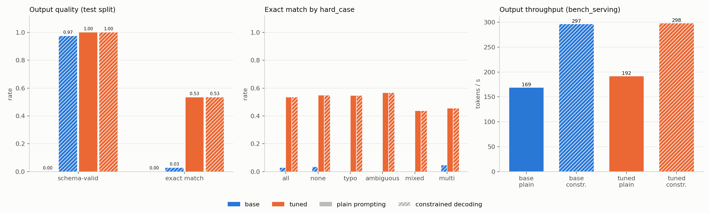

# TicketForge
Fine-tuning a small open LLM to turn messy support tickets into schema-valid JSON.
Served and benchmarked with SGLang. Built for Syntax Error 2026 (Local LLM Track).

Track: Local LLM, Problem Statement 5 (Structured output and extraction).

## Published artifacts

- Dataset: https://huggingface.co/datasets/bharataggarwal56/ticketforge-data
- Merged model: https://huggingface.co/bharataggarwal56/ticketforge-qwen2.5-1.5b-merged
- LoRA adapter: https://huggingface.co/bharataggarwal56/ticketforge-qwen2.5-1.5b-lora

## Results at a glance

- Qwen2.5-1.5B-Instruct, LoRA fine-tuned on 1,349 synthetic tickets, evaluated on a held-out split of 300 tickets from unseen templates and styles.
- The tuned model is 100% schema-valid with or without constrained decoding; the base model is 0.000 plain and 0.973 constrained.
- Exact match over the 5 structured fields goes from 0.027 (base, constrained) to 0.533 (tuned).
- Priority (0.70) and needs_human (0.84) are the weakest fields.
- Synthetic, template-based data, one seed, one run; see Limitations.

| model / mode | schema-valid | exact match |
|---|---|---|
| base / plain | 0.000 | 0.000 |
| base / constrained | 0.973 | 0.027 |
| tuned / plain | 1.000 | 0.533 |
| tuned / constrained | 1.000 | 0.533 |

## Pipeline

```text
synthetic generator (src/gen_tickets.py)
  -> CuratorKIT curation (src/curate.py)
  -> HF dataset (bharataggarwal56/ticketforge-data)
  -> AlignTune LoRA SFT on Colab T4 (Notebook A)
  -> merged model (HF)
  -> SGLang serving, plain and constrained (Notebook B)
  -> AuditKIT scoring + sglang.bench_serving
```

- **SGLang:** serves the base and merged tuned model through an OpenAI-compatible API, with and without `response_format` schema-constrained decoding, and `sglang.bench_serving` gives latency and throughput.
- **CuratorKIT:** dedups, cleans and pseudonymizes PII in the generated tickets, then exports `sft_messages.jsonl` with the system prompt.
- **AlignTune:** runs LoRA SFT of Qwen2.5-1.5B-Instruct on the curated messages, then the adapter is merged for serving.
- **AuditKIT:** runs the test split against the SGLang server and applies the custom scorers (schema-valid, per-field accuracy, exact match, summary F1).

## Output schema and labeling rules

The model must reply with one JSON object with exactly these keys, defined in `configs/schema.json` (`additionalProperties: false`, all keys required):

| Field | Type | Constraint |
|---|---|---|
| category | string | `billing`, `technical`, `account`, `shipping`, `other` |
| priority | string | `low`, `medium`, `high`, `urgent` |
| product | string | 1-60 characters, as written in the ticket |
| sentiment | string | `negative`, `neutral`, `positive` |
| summary | string | 1-160 characters, at most 20 words (enforced by a word-count `pattern`), no personal details |
| needs_human | boolean | true only if the customer asks for a person, agent, supervisor or callback, else false |

Labeling rules from the system prompt in `src/prompt.py`:

- If the ticket mentions several problems, category and product come from the first one and priority is the highest one mentioned.
- If it describes one problem but explicitly requests a different action, the requested action decides the category.
- If sentiment is mixed, use the last sentiment expressed.

The summary word-count `pattern` was not used for constrained serving: the SGLang server rejected the full schema, so constrained decoding used the schema without it. The scorer still validates every output against the full schema.

## Data

Synthetic, label-first tickets from `src/gen_tickets.py` (seed 42): labels are sampled first and the ticket is rendered to match, so gold JSON is correct by construction. Train and test use disjoint phrase banks and styles; a leakage check (no shared bank IDs, no shared 8-grams) runs on every generation. Design: `docs/plan.md` §1.

```bash
python src/gen_tickets.py --n 1500          # -> data/raw/{train,test}_pool.jsonl
python -m unittest discover tests
```

| | Train pool | Test pool |
|---|---|---|
| Rows | 1,500 | 300 |
| Styles | email, chat, tweet (500 each) | formal letter, voice transcript (150 each) |
| category / priority / sentiment / needs_human | balanced (300 / 375 / 500 / 750 per value) | balanced (60 / 75 / 100 / 150 per value) |
| Hard cases | 300 (20%): 75 each ambiguous, mixed, multi, typo | 90 (30%): 23 ambiguous, 23 mixed, 22 multi, 22 typo |
| Ticket words (min / mean / max) | 21 / 38.0 / 72 | 31 / 50.3 / 83 |
| Summary words (min / mean / max) | 5 / 9.3 / 18 | 7 / 11.2 / 20 |
| Leakage check | passed | |

### Curation (CuratorKIT 0.1.22, `src/curate.py`)

```bash
python src/curate.py --tag 2026-10-24      # -> data/curated/{train,test}_<tag>/
```

Train and test are curated in separate runs. Minhash dedup (threshold 0.85), cleaning and PII pseudonymization (emails, phones, card numbers, etc.; ticket text only) run, then `sft_messages.jsonl` is exported with the system prompt from `src/prompt.py`. Post-checks confirm every row is system/user/assistant, every label is schema-valid and unchanged, and every product name survived.

| Run | Raw | Exported | Near-duplicates removed | Rejected |
|---|---|---|---|---|
| train | 1,500 | 1,499 (train 1,349 / validation 150) | 1 (two identical tweet tickets differing only in email) | 0 |
| test | 300 | 300 (+ `test_meta.jsonl` with `hard_case`) | 0 | 0 |

### Training (Notebook A, `notebooks/A_train.ipynb`)

Curated data is in the HF dataset `bharataggarwal56/ticketforge-data` (`train_2026-10-24/`, `test_2026-10-24/`). The notebook runs AlignTune LoRA SFT of Qwen2.5-1.5B-Instruct on a Colab T4 in fp16, pushes a checkpoint to HF each epoch, then pushes the adapter and merged model. It is generated by `notebooks/build_A_train.py`. Setup: add a Colab secret named `HF_TOKEN`.

| Check (laptop) | Result |
|---|---|
| Token length, full example (train + validation) | max 361, p99 342, mean 306.7 |
| Token length, assistant answer | max 65, p99 60 |
| `max_seq_length` | 384, so no example is truncated |
| `aligntune advise estimate` (T4, seq 384) | VRAM 3.1 GB at batch 4, 2.2 GB at batch 2 (±30%) |

**Run (Colab T4).** Qwen2.5-1.5B-Instruct, LoRA r=16, alpha=32, dropout 0.05 on q, k, v, o, gate, up, down (18,464,768 trainable of 1,562,179,072 parameters, 1.18%). fp16, lr 2e-4, batch 4 x grad accumulation 2 (effective 8), `max_seq_length` 384, 3 epochs, 505 steps, evaluated and checkpointed every 168 steps. Training time 1032 s (about 17 min).

| Step | Train loss | Validation loss |
|---|---|---|
| 168 | 0.1326 | 0.1320 |
| 336 | 0.1001 | 0.1227 |
| 504 | 0.1087 | 0.1217 |

Final eval_loss 0.1217; mean token accuracy about 0.962-0.963. AlignTune's result dict also reported `final_loss` 0.2419, which does not match the last logged training loss (0.1087); it is listed here only as the trainer's reported value, without interpretation.

These losses and the token accuracy are computed over all tokens, including the roughly 250-token system prompt, so they are not task accuracy. The real results are the held-out test numbers below. Validation shares templates with train, so validation loss is not a generalization estimate.

### Evaluation (Notebook B, `notebooks/B_serve_eval.ipynb`)

`src/scorers.py` holds the metrics (strict `json.loads`, schema-valid, per-field accuracy, `exact_match_fields` as the headline, summary length and F1). `python -m unittest discover tests` checks them, runs AuditKIT against a stub server, and confirms `response_format` is forwarded. Notebook B serves the base and the merged tuned model with SGLang on one T4, evaluates plain and constrained decoding, runs `sglang.bench_serving`, and writes `results/baseline.json`, `results/tuned.json`, `comparison.md` and `comparison.png` (pushed to the HF dataset repo after each model). `RUN_BASE` / `RUN_TUNED` select the halves.

## Results

Setup: held-out test split (n=300), SGLang 0.5.22 on a Colab T4, fp16, triton attention backend, AuditKIT 1.1.3, temperature 0, max_tokens 256, one request at a time. Models: base Qwen2.5-1.5B-Instruct and the merged tuned model `bharataggarwal56/ticketforge-qwen2.5-1.5b-merged`. Source of truth: `results/baseline.json` and `results/tuned.json`.

The server rejected the full schema (the summary word-count pattern) for both models, so constrained decoding used the schema without that pattern (`schema_used = no_summary_pattern`). The scorer still validates every output against the full schema.



### 2x2: base/tuned x plain/constrained (test split, n=300)

| model / mode | schema-valid | exact match | category | priority | product | sentiment | needs_human | summary F1 | mean latency ms | req/s | out tok/s |
|---|---|---|---|---|---|---|---|---|---|---|---|
| base / plain | 0.000 | 0.000 | 0.000 | 0.000 | 0.000 | 0.000 | 0.000 | 0.000 | 4824 | 3.25 | 169 |
| base / constrained | 0.973 | 0.027 | 0.660 | 0.263 | 0.987 | 0.537 | 0.557 | 0.245 | 2734 | 5.71 | 297 |
| tuned / plain | 1.000 | 0.533 | 0.937 | 0.697 | 1.000 | 0.937 | 0.840 | 0.423 | 4230 | 3.70 | 192 |
| tuned / constrained | 1.000 | 0.533 | 0.937 | 0.700 | 1.000 | 0.937 | 0.840 | 0.423 | 2738 | 5.74 | 298 |

Exact match is over the 5 structured fields (summary excluded). Latency and throughput are from `sglang.bench_serving` (random prompts, 310 in / 52 out tokens, 200 prompts, concurrency 16); the constrained rows send `response_format` with the schema.

### Exact match (5 structured fields) by hard_case

| model / mode | all | none | typo | ambiguous | mixed | multi |
|---|---|---|---|---|---|---|
| base / plain | 0.000 (n=300) | 0.000 (n=210) | 0.000 (n=22) | 0.000 (n=23) | 0.000 (n=23) | 0.000 (n=22) |
| base / constrained | 0.027 (n=300) | 0.033 (n=210) | 0.000 (n=22) | 0.000 (n=23) | 0.000 (n=23) | 0.045 (n=22) |
| tuned / plain | 0.533 (n=300) | 0.548 (n=210) | 0.545 (n=22) | 0.565 (n=23) | 0.435 (n=23) | 0.455 (n=22) |
| tuned / constrained | 0.533 (n=300) | 0.548 (n=210) | 0.545 (n=22) | 0.565 (n=23) | 0.435 (n=23) | 0.455 (n=22) |

### Reading the results

- **Schema validity.** The tuned model is already 100% schema-valid without constraints, so constrained decoding adds nothing for it; it mainly rescues the base model (0.000 to 0.973). In all five saved base/plain sample outputs the JSON is wrapped in a markdown code fence, which strict `json.loads` rejects; only five samples are stored, so this is not a count over all 300. Eight base/constrained outputs (0.973 x 300 = 292 valid) still fail the full schema; the saved samples do not show why, so the cause is not stated here.
- **Plain vs constrained (tuned).** Effectively identical. Priority 0.697 vs 0.700 is one prediction.
- **Quality gain.** Exact match goes from 0.03 (base, constrained) to 0.53 (tuned). Priority (0.70) and needs_human (0.84) are the weakest fields and drag exact match down; category and sentiment are 0.94 and product is 1.00.
- **Summary F1** is low by construction (0.42): test summary templates differ from train templates, so word overlap with the reference is limited even when the summary is reasonable.
- **Uncertainty.** With n=300, an exact match of 0.53 has a 95% interval of roughly plus or minus 6 points. The hard_case slices have only 22-23 rows each, so their intervals are roughly plus or minus 20 points and the differences between slices are not significant. No significant drop on hard cases was observed; this does not show the model handles them as well as easy ones.
- **Latency and throughput.** `bench_serving` used random prompts of fixed length, so these numbers describe the server, not the task, and the constrained and plain rows are not necessarily like-for-like. They are reported as measured; no claim is made that constrained decoding is faster. The per-request latency from the one-at-a-time evaluation runs (AuditKIT) is below for reference.

| model / mode | mean latency ms (1 request at a time) | p95 ms | req/s | out tok/s |
|---|---|---|---|---|
| base / plain | 1717 | 1973 | 0.58 | 38.8 |
| base / constrained | 1583 | 1871 | 0.63 | 39.5 |
| tuned / plain | 1048 | 1270 | 0.95 | 48.6 |
| tuned / constrained | 1302 | 1498 | 0.77 | 39.1 |

## Example

Three held-out test tickets with the tuned model's saved output (tuned / plain, from `sample_outputs` in `results/tuned.json`) and the gold JSON. `tuned.json` stores only 5 sample outputs and not the ticket text, so these are matched to the first five rows of the curated test split in order (each saved output has the same category and product as its row). Examples 1 and 3 match gold on all 5 structured fields; example 2 does not. They were picked to show a typical hit and a miss, not at random.

**Example 1** (letter, hard_case: typo): all 5 structured fields match.

Ticket:

```text
To whom it may conecrn,

Since the firmware upgrade, Orbit Laptop 14 fails to boot properly. Kindly guide me through repairing the faul. I require a resolution within twenty-four hours. Furthee informaiton can be supplied on request.

Respectfully,
Maya Silva
```

Tuned model output:

```json
{
  "category": "technical",
  "priority": "high",
  "product": "Orbit Laptop 14",
  "sentiment": "neutral",
  "summary": "User says firmware upgrade affecting Orbit Laptop 14.",
  "needs_human": false
}
```

Gold:

```json
{
  "category": "technical",
  "priority": "high",
  "product": "Orbit Laptop 14",
  "sentiment": "neutral",
  "summary": "The customer describes boot failure after firmware upgrade concerning Orbit Laptop 14.",
  "needs_human": false
}
```

**Example 2** (transcript, hard_case: none): differs on priority (gold `"low"`, model `"medium"`), needs_human (gold `true`, model `false`).

Ticket:

```text
[transcribed call] hello yes it is Quinn Sharma, i wish to merge two separate Loyalty Rewards profiles into one kindly update my sign-in details a reply within the next few weeks would be fine kindly arrange for a staff member to telephone me further information can be supplied on request um okay that is all, you can email me at lynchgeorge@example.net, bye
```

Tuned model output:

```json
{
  "category": "account",
  "priority": "medium",
  "product": "Loyalty Rewards",
  "sentiment": "neutral",
  "summary": "User says profile merge request affecting Loyalty Rewards.",
  "needs_human": false
}
```

Gold:

```json
{
  "category": "account",
  "priority": "low",
  "product": "Loyalty Rewards",
  "sentiment": "neutral",
  "summary": "Ticket about profile merge request on Loyalty Rewards; wants a human agent.",
  "needs_human": true
}
```

**Example 3** (transcript, hard_case: none): all 5 structured fields match.

Ticket:

```text
[voice message transcript] uh hi, this is Rosa Mehta calling, could you share details on the warranty terms for FitTrack Band there is no time pressure on this matter the experience so far has been dreadful um okay that is all, you can email me at jamesshawn@example.com, bye
```

Tuned model output:

```json
{
  "category": "other",
  "priority": "low",
  "product": "FitTrack Band",
  "sentiment": "negative",
  "summary": "Issue: information request (FitTrack Band).",
  "needs_human": false
}
```

Gold:

```json
{
  "category": "other",
  "priority": "low",
  "product": "FitTrack Band",
  "sentiment": "negative",
  "summary": "The customer describes warranty terms question concerning FitTrack Band.",
  "needs_human": false
}
```

## Limitations and future work

- Data is synthetic and template-based. The test split uses held-out templates and styles from the same generator, so real tickets will likely score lower.
- Labeling conventions for mixed, ambiguous and multi cases are our own.
- One model, one seed, one run. No human-labelled data. fp16 on a free T4.
- Priority is the weakest field, but `tuned.json` stores only 5 sample outputs, so no confusion matrix can be built and the cause is not analysed. Future work: save all predictions and analyse priority and needs_human errors.
- The cause of the 8 base/constrained schema failures is not determined, for the same reason.

## How to reproduce

**Quick path.** The dataset and models listed under Published artifacts are public, so Notebooks A and B can be run without regenerating data. The notebooks hardcode the HF username `bharataggarwal56`; anyone re-running under their own account must change `HF_USER`, `DATA_REPO`, `ADAPTER_REPO`, `MERGED_REPO` and `TUNED_MODEL`. `src/push_data.py` needs `HF_TOKEN` in a local `.env`.

**Laptop** (Python 3.11+, no GPU needed):

```bash
pip install -r requirements.txt
python -m spacy download en_core_web_sm
python src/gen_tickets.py --n 1500
python src/curate.py --tag 2026-10-24
python -m unittest discover tests
```

Do not install `aligntune` or `sglang` in the laptop venv. `src/push_data.py` uploads the curated data and code to the HF dataset repo.

**Colab (T4).** Add a Colab secret named `HF_TOKEN` (with notebook access enabled). Never paste a token into a notebook or commit it. Run the notebooks in order:

1. `notebooks/A_train.ipynb`: AlignTune LoRA SFT, pushes the adapter and merged model to HF. Uses the default Colab runtime (`pip install aligntune`); SGLang is not installed here.
2. `notebooks/B_serve_eval.ipynb`: serves base and merged tuned models with SGLang, runs AuditKIT and `sglang.bench_serving`, writes `results/`. SGLang lives in a separate uv Python 3.12 venv (`uv venv --python 3.12`, `uv pip install --prerelease=allow sglang`); AuditKIT is installed in the default runtime and talks to the server over HTTP. AlignTune is not installed here.

The environments are kept separate because AlignTune and SGLang pin conflicting `transformers` and torch versions. The notebooks are generated by `notebooks/build_A_train.py` and `notebooks/build_B_serve_eval.py`.

Executed copies of both notebooks with their saved outputs are in notebooks/executed/; the notebooks in notebooks/ are the clean, regenerable versions.

## Licenses of the toolkits

From `docs/tools.md`: CuratorKIT is LSAL v1.1 (non-commercial); AlignTune is MIT (its vendored Unsloth backend brings in AGPL components, while the TRL backend runs no AGPL code); AuditKIT is LSAL v1.2 (source-available). Check each project's repository before any commercial use.
